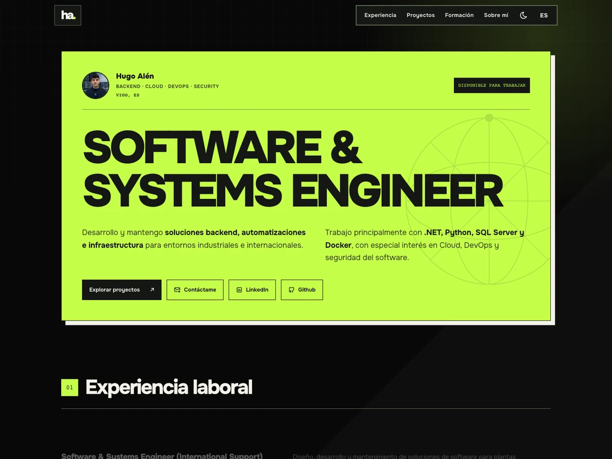

# Portfolio de Hugo Alén

Portfolio profesional de **Hugo Alén, Software & Systems Engineer**, enfocado en backend, automatización, infraestructura, Cloud, DevOps y seguridad del software.

Reúne mi experiencia, proyectos personales, formación y vías de contacto. Incluye un CMS privado para mantener el contenido actualizado desde el navegador, también en móvil.

**[Ver portfolio](https://hugoalen.vercel.app/)**

[](https://hugoalen.vercel.app/)

## Funcionalidades

- Presentación, experiencia profesional, proyectos, formación y sección sobre mí.
- Contenido en español e inglés.
- Tema claro, oscuro y según el sistema, con preferencia guardada.
- Diseño responsive, navegación móvil y protección del contenido mediante Safe Areas.
- Galería de productos con tarjetas animadas mediante GSAP en escritorio y navegación táctil en móvil; respeta la preferencia de movimiento reducido.
- Panel privado con inicio de sesión de Google y edición mediante formularios.
- Contenido inicial en JSON y actualizaciones desde Cloud Firestore.
- Metadatos SEO, Open Graph y tarjetas para compartir enlaces.

## Tecnologías

Astro, TypeScript y Tailwind CSS para la web; GSAP y ScrollTrigger para las animaciones; Firebase Authentication y Cloud Firestore para el CMS. Despliegue estático en Vercel.

Las decisiones visuales y las referencias del rediseño están documentadas en [DESIGN.md](./DESIGN.md).

## Desarrollo local

Requisitos: **Node.js 22.12 o superior** y **pnpm 10.28.2**, según la configuración del proyecto.

```bash
pnpm install
pnpm dev
```

Abre la dirección que indique Astro en la terminal, normalmente `http://localhost:4321`.

Para conectar Firebase, crea `.env.local` usando los nombres de variables de [.env.example](./.env.example) y configura tu proyecto de Firebase. No subas `.env.local` ni credenciales privadas al repositorio.

```bash
pnpm astro check  # Diagnósticos de Astro y TypeScript
pnpm build        # Validación y compilación en dist/
pnpm preview      # Vista previa de la compilación
```

## Gestión del contenido

El panel se encuentra en `/admin`:

- `/admin/projects`: proyectos, tecnologías, referencias de imágenes, enlaces y visibilidad.
- `/admin/content`: perfil y hero, sobre mí, experiencia y formación.

Los formularios guardan en Firestore. Los JSON de `src/data/` proporcionan el contenido de la compilación y pueden importarse desde el panel como datos iniciales. Cambiar un JSON no sustituye automáticamente el contenido que ya existe en Firestore.

Para habilitar el CMS en otra instalación, configura el acceso con Google, los dominios autorizados y las reglas de [firestore.rules](./firestore.rules). Las reglas autorizan las escrituras; configurar `PUBLIC_ADMIN_EMAIL` por sí solo no concede permisos. Si usas otro administrador, actualiza también el correo autorizado en las reglas.

Las imágenes locales se almacenan en `public/projects/`. La subida de archivos desde el CMS queda pendiente; actualmente se edita su referencia.

Más información sobre la estructura de los datos en [CONTENT.md](./CONTENT.md).

## Estructura

```text
public/          Imágenes, capturas, favicon y CV
src/components/ Secciones, navegación y controles de tema e idioma
src/data/       Contenido JSON y validación
src/layouts/    Layout compartido y metadatos
src/lib/        Configuración de Firebase y utilidades
src/pages/      Portfolio y rutas del CMS
src/styles/     Estilos globales
firestore.rules Reglas de acceso a los datos
```

## Despliegue

En Vercel, configura las variables de `.env.example`, usa `pnpm build` como comando de compilación y `dist` como directorio de salida. Las variables públicas se incorporan al compilar: si cambian, es necesario desplegar de nuevo.

## Licencia

Consulta [LICENSE.md](./LICENSE.md).
