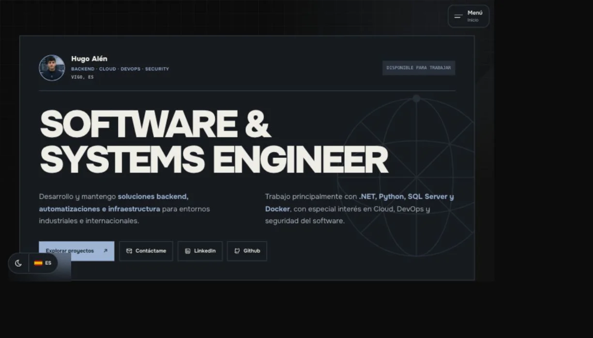

# Portfolio de Hugo Alén

Portfolio profesional de **Hugo Alén, Software & Systems Engineer**, enfocado en backend, automatización, infraestructura, Cloud, DevOps y seguridad del software.

Reúne mi experiencia, proyectos personales, formación y vías de contacto. El contenido se mantiene en JSON y un panel privado permite activar mantenimiento desde cualquier dispositivo.

**[Ver portfolio](https://hugoalen.vercel.app/)**

[](https://hugoalen.vercel.app/)

## Funcionalidades

- Presentación, experiencia profesional, proyectos, formación y sección sobre mí.
- Contenido en español e inglés.
- Tema claro, oscuro y según el sistema, con preferencia guardada.
- Diseño responsive, navegación móvil y protección del contenido mediante Safe Areas.
- Galería de productos con tarjetas animadas mediante GSAP en escritorio y navegación táctil en móvil; respeta la preferencia de movimiento reducido.
- Panel privado con inicio de sesión de Google e interruptor de mantenimiento.
- Contenido en JSON como fuente única: Firebase no sustituye textos ni proyectos.
- Metadatos SEO, Open Graph y tarjetas para compartir enlaces.

## Tecnologías

Astro, TypeScript y Tailwind CSS para la web; GSAP y ScrollTrigger para las animaciones; Firebase Authentication para el panel y un ajuste de disponibilidad en Firestore. Contenido estático en Vercel con Routing Middleware para controlar la portada.

Las decisiones visuales y las referencias del rediseño están documentadas en [DESIGN.md](./DESIGN.md).

## Desarrollo local

Requisitos: **Node.js 22.12 o superior** y **pnpm 10.28.2**, según la configuración del proyecto.

```bash
pnpm install
pnpm dev
```

Abre la dirección que indique Astro en la terminal, normalmente `http://localhost:4321`.

Para conectar Firebase, crea `.env.local` usando los nombres de variables de [.env.example](./.env.example) y configura tu proyecto de Firebase. No subas `.env.local` ni credenciales privadas al repositorio.

```bash
pnpm astro check  # Diagnósticos de Astro y TypeScript
pnpm build        # Validación y compilación en dist/
pnpm preview      # Vista previa de la compilación
```

## Gestión del contenido

Los archivos de `src/data/` son la única fuente de contenido. Editarlos y desplegar actualiza la web; no hay importaciones ni sincronización con Firestore. Consulta [CONTENT.md](./CONTENT.md).

`/admin` conserva acceso con Google para la cuenta autorizada y permite activar mantenimiento o volver a mostrar el portfolio. Las rutas antiguas `/admin/projects` y `/admin/content` redirigen al panel, sin editores.

Antes de retirar el CMS se guardó una copia privada del contenido publicado en `.private/legacy-cms-backup.json`. Los documentos remotos antiguos no se han borrado ni se usan para renderizar contenido. `scripts/backup-legacy-cms.mjs` permite repetir la exportación de contenido publicado; no incluye borradores o documentos ocultos.

### Previews de proyectos

Las previews vuelven al catálogo. Las ocho capturas corporativas exportadas están en `public/projects/marsan/`, con ocultación opaca aplicada a los píxeles y aviso incorporado. Los originales se guardan únicamente en `.private/PreviewsProyectosMarsan/`, excluidos de Git y del despliegue. `scripts/prepare-marsan-previews.py` reproduce las ocultaciones aprobadas sobre esos originales; requiere Pillow. Revisar visualmente cualquier exportación antes de publicarla. No mover originales de vuelta a `public`.

El catálogo presenta capturas con un marco común; los tres casos destacados mantienen su formato editorial compacto. `src/data/marsan-projects.json` contiene ocho casos profesionales redactados sin datos internos ni métricas no verificadas. Para identificadores de Marsan, el renderizador solo utiliza los archivos saneados de `src/lib/marsan-preview-assets.ts`, sin utilizar originales corporativos.

Las tarjetas comparten `src/lib/project-preview.ts` y `src/styles/project-preview.css`: misma proporción, marco y espaciado. Las capturas son archivos locales en `public/projects`; no se generan ni descargan en cada visita. Las rutas antiguas de imágenes se resuelven en `src/lib/public-assets.ts`.

FutPath, ZaiZen, Senda, SFit y ¿Quién finge? usan capturas locales nuevas, sin sesiones personales. PadelTime y Moto TV usan capturas incluidas en sus repositorios. oNoSoAlMaNaQuE conserva su imagen original y eliminan el marco antiguo mediante presentación CSS. TaskFlow y VehixHub tienen portadas vectoriales de arquitectura, no capturas ficticias de producto.

Para habilitar el panel en otra instalación, configura Google, los dominios autorizados y [firestore.rules](./firestore.rules). Las reglas existentes permiten leer `content/profile` y escribir solo al administrador. Por compatibilidad, ese documento conserva el booleano `maintenanceEnabled`; sus otros campos ya no se leen. No se necesitan reglas nuevas para esta transición. `PUBLIC_ADMIN_EMAIL` debe coincidir con el correo autorizado por las reglas.

Más información sobre la estructura de los datos en [CONTENT.md](./CONTENT.md).

## Estructura

```text
public/          Imágenes, capturas, favicon y CV
src/components/ Secciones, navegación y controles de tema e idioma
src/data/       Contenido JSON y validación
src/layouts/    Layout compartido y metadatos
src/lib/        Configuración de Firebase y utilidades
src/pages/      Portfolio, mantenimiento y panel privado
src/styles/     Estilos globales
firestore.rules Reglas de acceso a los datos
```

## Despliegue

### Mantenimiento

`/admin` guarda `content/profile.maintenanceEnabled` con una escritura parcial, sin modificar los datos antiguos. El documento o campo ausente significa portfolio visible. En Vercel, `middleware.ts` comprueba ese único campo antes de servir `/` o `/index.html` y redirige a `/maintenance` cuando está activo. No hay caché intencional; afecta a nuevas solicitudes, no a pestañas que ya estaban abiertas. El panel y Firebase Auth quedan fuera del middleware.

Si Firestore falla o devuelve un valor no válido, se muestra mantenimiento por precaución. Al desactivarlo, `/maintenance` vuelve a la portada. Astro aplica el mismo comportamiento en desarrollo local. El interruptor local comparte el estado con producción: no activarlo solo para pruebas sin querer afectar la web pública.

Esto controla presentación, no confidencialidad: imágenes, CV, archivos públicos y datos remotos históricos siguen siendo accesibles. Para eliminar datos ya publicados o revocar lecturas antiguas hace falta una revisión separada. No hay acceso secreto por parámetros de URL.


En Vercel, configura las variables de `.env.example`, usa `pnpm build` como comando de compilación y `dist` como directorio de salida. Las variables públicas se incorporan al compilar: si cambian, es necesario desplegar de nuevo.

## Licencia

Consulta [LICENSE.md](./LICENSE.md).
